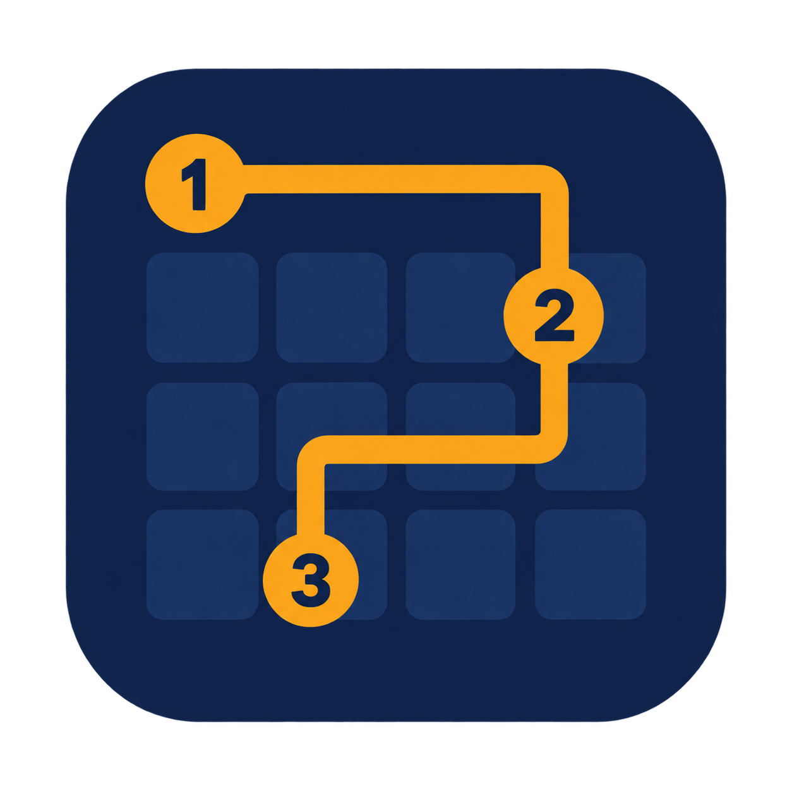

<p align="center">
  
</p>

# Yomi 🧩

**Yomi is a daily path puzzle that asks: what makes a puzzle hard for a person?**

Connect the numbered dots with one line. Everyone gets the same puzzle each day ("Yomi #N", changing at your local midnight). Before you start, Yomi shows a target to beat; when you finish, the result card shows it against your time, a countdown to the next daily, and a Practice button for the original 30 puzzles. Every solve is stored anonymously, and a model is retrained by hand, in batches, to learn what makes a puzzle hard for people. It does not update while you play.

Built for the ShiftKey Build It! ML project (Dalhousie). The showcase (Oct 29, 2026) is done; the project continues.

**Play it live: https://yomi-pi-topaz.vercel.app**

## The problem

Whether a puzzle is hard is easy to guess and hard to measure. Public datasets mostly rate difficulty by how much work a computer solver does, which is not the same as how long a person takes. We want to learn what makes a puzzle hard **for a person**: how long they take, and where they get stuck. That needs real human solves, so the game is also the data collector.

## What I built

- A Zip-style path puzzle (connect numbered dots in order and fill every cell) with a daily puzzle, a streak, a practice pool and a sprint mode.
- A solve pipeline that stores each anonymous attempt (the move log, nothing personal) and derives time, backtracks and the cell where you paused longest on the server.
- A small model (ridge regression on puzzle features) and a stuck-cell model (logistic regression), plus the code to train, evaluate and export them. Both are retrained by hand in batches.
- Pages that show the data and the model's state honestly: `/learn`, `/stats`, `/you`, `/what-we-store`.

## What works today

- Playing, solving, the daily and its countdown, practice and Extreme, on phones and desktops. The web and ml test suites pass (`npm test`, `python -m unittest discover -s ml -p "test_*.py" -t .`).
- Every solve is stored once (duplicates dropped), with time and pauses computed server-side from the moves.
- Public-data analysis (Sprint 1): puzzle size and shape track difficulty. Queens grid size ρ = +0.84 against solver effort; Lichess solution length ρ = +0.55 against real human ratings ([findings](reports/sprint1_findings.md)).
- The target above the puzzle is one of three things, and it says which:
  - **Crowd median:** the typical time from previous recorded solves of that puzzle (shown once 3+ exist). It is **not an ML prediction**, and the count is solves, not players.
  - **Solver effort:** how hard a computer found the puzzle, as a relative read ("on the easier side") and a step count. It is **not a human solve time**. This is what the model outputs today.
  - **A human-time prediction:** shown only when a model trained on human solve times is actually deployed. None is yet.
  The target is locked at your first move, so it cannot change while you play.

## What is not validated yet

- **No human-time model exists.** The last retrain (2026-10-22) used 7 usable solves from 1 player, so the model is still on the solver-effort stand-in. The rule for fitting human time is 15+ usable solves; the stuck-cell model needs 30+.
- **No accuracy has been measured.** The leave-one-player-out evaluations are written and unit-tested on synthetic data, but have not been run on real data (they need 2+ players). There is no "within 20%" or hit-rate result.
- **Nothing shows people come back.** The daily and the streak are new and unmeasured. See the playtest below.
- The model does not learn while you play. Your solve is used only when someone retrains it.

## Presentation feedback

Qualitative classroom feedback after the ML presentation, paraphrased. It is not a user study and says nothing about retention or model accuracy.

- Peers enjoyed playing the demo, and liked how the game is designed to collect solve data.
- They found the problem statement unclear.
- They wanted stronger predictions.

What changed because of it: this README and the line above the game now state the question up front, and the target says what it is (above). Stronger predictions need real human solves, so we are collecting them, not lowering the training thresholds to make predictions look better.

## Seven-day playtest

A small playtest is prepared in [PLAYTEST.md](PLAYTEST.md): participants, return players and daily completion from the anonymous records we already store (`python -m ml.playtest`), what those records cannot say (a player id is a browser, not a person; an attempt is not a visit), and two questions to ask by hand. It has not been run yet.

## The pitch (Hook → Fix → Proof)

**Hook:** Everyone's played a puzzle and thought "I'll get this in 30 seconds" and then lost 10 minutes. Yomi knows that about you before you start. 👀

**Fix:** Yomi is a daily Zip-style path puzzle with an ML model under the hood. The model reads the puzzle (grid size, gaps, turns, solver effort) and, once it has the data, your past solves, to predict your time before you play and your stuck spots for the result card. You play, you see the receipts, and you come back tomorrow.

**Proof:**
- Sprint 1: on public data, puzzle size and shape predict difficulty. Queens grid size hits ρ = +0.84 against solver effort. Lichess solution length hits ρ = +0.55 against real human ratings. ([findings](reports/sprint1_findings.md))
- Sprint 2: the solve pipeline is idempotent. Duplicate submits are dropped, results are derived on the server, and 429s get queued instead of lost.
- Sprint 3: a daily puzzle (120 pre-generated, cycling), a streak for solving it, and a countdown to the next one. Built and tested; not deployed yet.
- Honest status: the model is still on its solver-effort fallback. Its last retrain (2026-10-22) used 7 usable solves from 1 player. That's not enough for a human-time model yet (the rule is 15+ solves), so its output is solver steps, not milliseconds.
- The target you see before a puzzle is a crowd median (typical time from previous recorded solves, not an ML prediction), a solver-effort read (difficulty for a computer, not a human time), or, once such a model is deployed, a human-time prediction. It says which. We're not hiding any of this.

## Current sprint: Sprint 3 (started Oct 22; the showcase is done)

**Goal:** make Yomi something people come back to, and collect the real solves the model needs.

### Done ✅
- **Daily puzzle:** `daily-001`..`daily-120` are appended to `web/data/puzzles.json` (5x5 and 6x6, plus a 7x7 every tenth day, each verified to have exactly one solution). Day 0 is 2026-11-03; the day is the player's local calendar day and the pool cycles, so after 120 days the numbers repeat. A new visitor sees the skippable tutorial, then today's daily. After solving: the result card, a countdown to the next daily (local midnight) and a **Practice** button over the original 30 puzzles. Reopening the page the same day shows today's result. The streak counts only days whose daily was solved. Extreme and `/demo` still play the original 30 only. The 30 original puzzles are frozen (a test hashes them) because stored solves reference them. Known tradeoff: the browser gets the whole puzzle list, so upcoming dailies are technically visible.
- **Early time estimate:** while the model predicts solver steps, a puzzle with 3+ finished Regular solves shows the crowd median as the target. It is locked at the first move and saved with the solve as `model_version = crowd-median`; the stats and share pages name it as a crowd median, not a Yomi prediction. A model that predicts time wins over it.
- **Training hygiene:** `web/migrations/007_test_rows.sql` marks rows 1 to 8 as `source = 'test'` (written, **not applied yet**); training drops those rows. The time model now fits human time from 15 usable solves (`MIN_HUMAN_SOLVES`); the stuck model still needs 30.
- **Cleanup:** `npm run typecheck`; the create-next-app README and unused SVGs are gone.

### Still open ⏸️
- **Stuck-point model:** code and tests are done (`ml/train_stuck.py`). The fit is skipped below 30 usable solves, so no stuck cells are predicted yet.
- **Human-time model and evaluation:** `python -m ml.pipeline` exports and writes `reports/sprint2_model.md`, but both leave-one-player-out evals say "not run" until there are 2+ players and enough solves.
- **Apply migration 007 in Neon, then deploy.** Neither has happened.
- **Get real solves** (the real blocker). Share the live link with friends.
- **Personalization and model-tuned daily difficulty** are not built. The dailies are a fixed pool in a fixed order, and a tuned difficulty only makes sense once a model trained on human times exists.
- **Retrain when there is data:** `python -m ml.pipeline --source neon` appends to `web/public/model_history.json` and keeps the run's report in `reports/history/`. A retrain after 2026-11-03 fits the solver-effort stand-in on all 150 puzzles, 7x7 included.

### Earlier sprints
- **Sprint 2 (Oct 15 to 22):** data quality (dedupe by `solve_id`, results derived on the server), deploy on Vercel + Neon, `ml/features.py`, the prediction UI, the learning pages (`/learn`, `/stats`, `/you`), the `/demo` projector screen and Extreme (a sprint mode, not trained on). The result card shows the target against the actual time; if `model.json` is missing the game runs without predictions.
- **Sprint 1:** public-data analysis in `reports/sprint1_findings.md`.

## Run it locally

```bash
# web app
cd web
npm install
npm run dev            # http://localhost:3000
npm test               # game + store tests
npm run typecheck && npm run lint && npm run build

# ml
python3 -m venv .venv && source .venv/bin/activate
pip install -r requirements.txt
python -m ml.train_time --source jsonl   # retrain the time model from data/solves.jsonl
python -m unittest discover -s ml -p "test_*.py" -t .
```

Without `DATABASE_URL`, solves go to `data/solves.jsonl`. With it, they go to Neon.

## Repo map

- `web/`: Next.js 16 + React 19 + Tailwind 4. The game lives in `components/ZipGame.tsx`, puzzle logic in `lib/zip.ts`, the daily in `lib/daily.ts`, and the API in `app/api/`. `data/puzzles.json` holds the 30 original puzzles (never change them) and the 120 dailies (`npm run gen:daily` appends; never run `npm run gen:puzzles`).
- `ml/`: features, training, export, and tests. Writes `web/public/model.json`.
- `analysis.py`, `prep_datasets.py`: public-dataset analysis and data prep.
- `reports/`: Sprint 1 findings and plots.
- `DEMO.md`: showcase talk track.
- `CLAUDE.md`: project brief and sprint plan for the AI coding assistant.

## Privacy

Anonymous only. Players get a random ID stored in their browser. No names, emails, or IP addresses are stored.

---

Owner: Alamedin Sabit ([@Lameda12](https://github.com/Lameda12))
